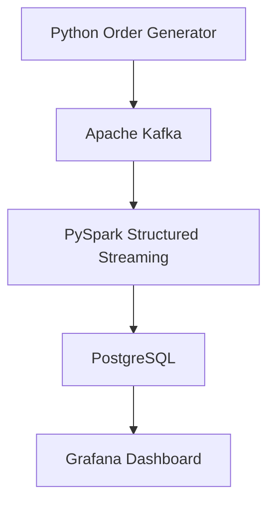
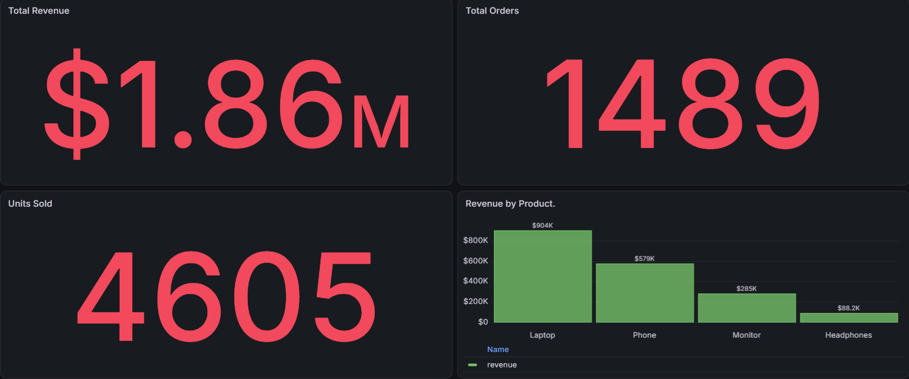

# Real-Time E-Commerce Data Engineering Pipeline

## Project Overview

This project demonstrates an end-to-end real-time data engineering pipeline that processes simulated e-commerce orders using Apache Kafka, PySpark Structured Streaming, PostgreSQL, and Grafana.

The pipeline generates order events using Python, streams them through Apache Kafka, processes and filters confirmed orders using PySpark, and stores the results in PostgreSQL.

Grafana connects to PostgreSQL to visualize key business metrics, including total revenue, total orders, units sold, revenue by product, and sales trends over time.

## Technologies Used

- **Python:** Generates simulated e-commerce transactions and publishes events to Kafka.
- **Apache Kafka:** Handles real-time order event streaming.
- **Apache Spark (PySpark):** Processes streaming data and filters confirmed orders.
- **PostgreSQL:** Stores processed order records for analysis.
- **Grafana:** Visualizes business metrics through an interactive dashboard.
- **Docker:** Runs Kafka and Grafana containers.
- **Git and GitHub:** Version control and project documentation.

## Data Pipeline Architecture

```text
Python Order Generator
          |
          v
     Apache Kafka
          |
          v
PySpark Structured Streaming
          |
          v
     PostgreSQL
          |
          v
    Grafana Dashboard
```

## Key Features

- Real-time generation and streaming of simulated e-commerce orders
- Kafka-based event ingestion
- Streaming data processing with PySpark
- Filtering of confirmed orders for sales analytics
- PostgreSQL integration for persistent data storage
- Grafana dashboards for monitoring sales performance
- Docker-based deployment of Kafka and Grafana


## Installation and Setup

### Prerequisites

Make sure the following tools are installed:

- Python 3
- Java (compatible with PySpark 4.0.1)
- Docker and Docker Compose
- PostgreSQL
- Git

### 1. Clone the Repository

```bash
git clone <YOUR_GITHUB_REPOSITORY_URL>
cd realtime-ecommerce
```

Replace the placeholder with the repository URL after publishing the project.

### 2. Create a Python Virtual Environment

```bash
python3 -m venv .venv
source .venv/bin/activate
```

### 3. Install Python Dependencies

```bash
pip install -r requirements.txt
```

### 4. Start Kafka and Grafana

Start the Docker services defined in `compose.yaml`:

```bash
docker compose up -d
```

Verify the containers:

```bash
docker ps
```

Ensure the Kafka topic `ecommerce-orders` exists before starting the producer.

### 5. Configure PostgreSQL

Create a PostgreSQL database named `ecommerce` and configure the `orders` table with the schema required by the database writer.

Set the PostgreSQL password in your terminal:

```bash
read -rsp "PostgreSQL password: " POSTGRES_PASSWORD
echo
export POSTGRES_PASSWORD
```

Check `db_config.py` for the connection settings, including the database host and port.

### Create the Orders Table

After creating the PostgreSQL database, run the SQL schema:

```bash
psql -h localhost -p 5433 -U postgres -d ecommerce -f schema.sql

### 6. Start PySpark Streaming

In the project directory, with the virtual environment active and PostgreSQL configured:

```bash
python -u spark_kafka_stream.py
```

Keep this terminal running.

### 7. Start the Kafka Producer

Open a second terminal, activate the virtual environment, and run:

```bash
python kafka_producer.py
```

The producer generates simulated e-commerce order events and sends them to Kafka.

### 8. View the Grafana Dashboard

Open:

http://localhost:3000

Configure a PostgreSQL data source, then create panels for:

- Total Revenue
- Total Orders
- Units Sold
- Revenue by Product
- Sales Trend Over Time

The sales pipeline processes confirmed orders for analytics.

## Pipeline Validation

The pipeline was tested by generating five confirmed orders.

- All five messages were acknowledged by Apache Kafka.
- All five corresponding order records were found in PostgreSQL.
- Grafana successfully displayed sales metrics from the database.

This validates the core ingestion, streaming, storage, and visualization components.


## Pipeline Architecture




## Grafana Dashboard

The dashboard visualizes real-time e-commerce sales data processed through Apache Kafka, PySpark Structured Streaming, and PostgreSQL.




## Automated Testing

This project uses Pytest to validate e-commerce order data before it enters the streaming pipeline.

### Test Coverage

- Valid order validation
- Invalid quantity detection
- Missing required field detection
- Incorrect total amount detection

### Install Testing Dependencies

```bash
python -m pip install -r requirements-dev.txt
```

### Run Tests

```bash
python -m pytest tests/ -v
```

### Latest Test Results

All 4 order validation tests passed successfully.
