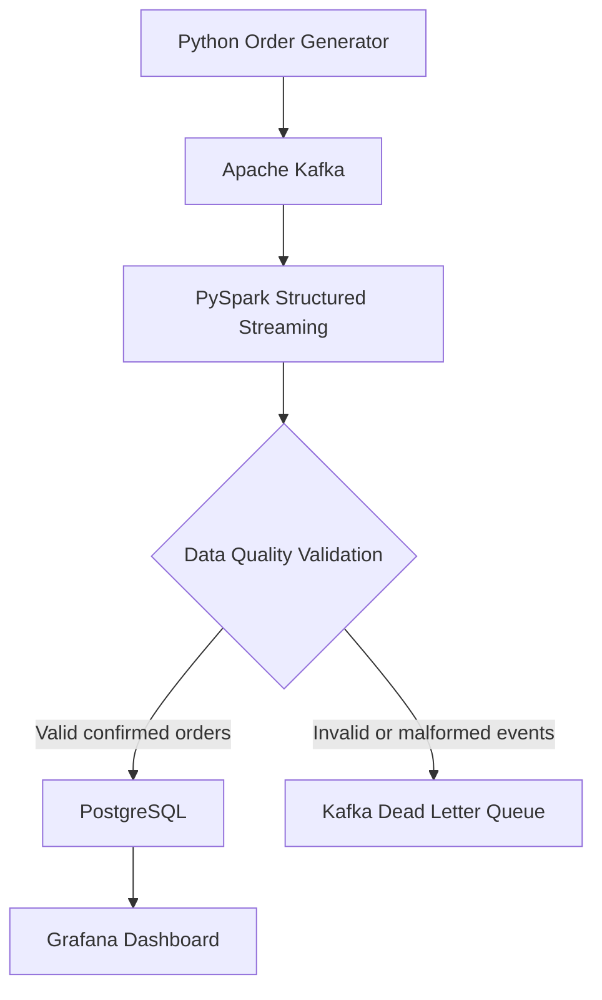

# Real-Time E-Commerce Data Engineering Pipeline


[](https://github.com/Shoaib551999/real-time-ecommerce-data-pipeline/actions/workflows/tests.yml)


## Project Overview

This project implements an end-to-end real-time e-commerce data engineering pipeline using Python, Apache Kafka, PySpark Structured Streaming, PostgreSQL, and Grafana.

A Python producer generates simulated e-commerce order events and publishes them to Apache Kafka. PySpark consumes these events in micro-batches, parses JSON messages, and validates order data before processing.

Valid confirmed orders are stored in PostgreSQL and visualized through a Grafana dashboard displaying total revenue, total orders, units sold, and sales trends.

Invalid orders and malformed JSON events are routed to a dedicated Kafka Dead Letter Queue (DLQ) for investigation.

The pipeline also includes Spark checkpointing for recovery, duplicate-order protection in PostgreSQL, structured logging, automated testing with Pytest, and Continuous Integration using GitHub Actions.


## Technologies Used

| Technology | Purpose |
|---|---|
| Python | Generates and validates simulated e-commerce orders |
| Apache Kafka | Ingests and streams order events in real time |
| PySpark Structured Streaming | Processes Kafka messages, validates orders, and routes records |
| PostgreSQL | Stores validated confirmed orders for analytics |
| Grafana | Visualizes sales metrics through a real-time dashboard |
| Docker & Docker Compose | Runs Kafka and Grafana services |
| Pytest | Automates order-validation and Spark data-quality tests |
| GitHub Actions | Runs automated tests through Continuous Integration (CI) |
| Git & GitHub | Provides version control and project documentation |

### Key Engineering Concepts

- Real-time event streaming and micro-batch processing
- Data-quality validation and Dead Letter Queue (DLQ)
- Spark checkpointing and recovery
- Duplicate-order prevention and PostgreSQL bulk inserts
- Structured logging, automated testing, and CI


## Data Pipeline Architecture


## Grafana Dashboard

The dashboard visualizes real-time e-commerce sales data processed through Apache Kafka, PySpark Structured Streaming, and PostgreSQL.


## Key Features

- **Real-Time Data Ingestion:** Generates simulated e-commerce transactions using Python and publishes them to Apache Kafka.
- **Stream Processing:** Uses PySpark Structured Streaming to consume Kafka events and process them in micro-batches.
- **Data Quality Validation:** Validates order IDs, customer information, quantities, prices, statuses, and calculated totals.
- **Dead Letter Queue (DLQ):** Routes malformed JSON and invalid orders to a separate Kafka topic for investigation.
- **PostgreSQL Integration:** Stores validated confirmed orders using efficient batch inserts.
- **Duplicate Prevention:** Uses PostgreSQL primary keys and `ON CONFLICT DO NOTHING` to avoid duplicate order records.
- **Fault Tolerance:** Uses Spark checkpoints to resume processing after application restarts.
- **Real-Time Analytics:** Visualizes revenue, total orders, units sold, and sales trends using Grafana.
- **Structured Logging:** Records batch-processing information and errors to support troubleshooting.
- **Automated Testing:** Includes 10 Python and PySpark tests using Pytest.
- **Continuous Integration:** Uses GitHub Actions to run automated tests after code changes.


## Installation and Setup

### Prerequisites

Make sure the following tools are installed:

- Python 3
- Java (compatible with PySpark 4.0.1)
- Docker and Docker Compose
- PostgreSQL
- Git


### 1. Clone the Repository

Clone the project from GitHub:

```bash
git clone https://github.com/Shoaib551999/real-time-ecommerce-data-pipeline.git
cd real-time-ecommerce-data-pipeline
```


### 2. Create a Python Virtual Environment

```bash
python3 -m venv .venv
source .venv/bin/activate
```

### 3. Install Python Dependencies

```bash
pip install -r requirements.txt
```

### 4. Start Kafka and Grafana

Start the Docker services defined in `compose.yaml`:

```bash
docker compose up -d
```

Verify the containers:

```bash
docker ps
```

Ensure the Kafka topic `ecommerce-orders` exists before starting the producer.


### 5. Configure PostgreSQL

Create a PostgreSQL database named `ecommerce` and use the included `schema.sql` file to create the orders table.

Set the PostgreSQL password securely in your Ubuntu terminal:

```bash
read -rsp "PostgreSQL password: " POSTGRES_PASSWORD
echo
export POSTGRES_PASSWORD
```

Create the orders table:

```bash
psql -h localhost -p 5433 -U postgres -d ecommerce -f schema.sql
```

Ensure PostgreSQL is running and accessible on port `5433`.

The database connection settings are defined in `db_config.py`.


### 6. Start PySpark Streaming

Activate your Python virtual environment and ensure PostgreSQL credentials are configured.

Start the Spark Structured Streaming application:

```bash
python -u spark_kafka_stream.py
```

The application reads order events from Kafka, validates the incoming data, and routes events to the appropriate destination:

- Valid confirmed orders are written to PostgreSQL.
- Invalid orders and malformed JSON messages are sent to the Kafka Dead Letter Queue (`ecommerce-orders-dlq`).

Spark uses separate checkpoint directories for PostgreSQL and the DLQ to track streaming progress.

Keep this terminal running while the pipeline processes events.


### 7. Start the Kafka Producer

Open a second Ubuntu terminal while keeping Spark Streaming running in the first terminal.

Activate the Python virtual environment:

```bash
source .venv/bin/activate
```

Start generating e-commerce order events:

```bash
python -u kafka_producer.py
```

The Python producer generates simulated e-commerce orders with unique order IDs and publishes them to the Kafka topic `ecommerce-orders`.

PySpark Structured Streaming consumes these events, validates the order data, and processes them according to their status and data quality.

Confirmed valid orders are stored in PostgreSQL, while invalid events are routed to the Kafka Dead Letter Queue.


### 8. View the Grafana Dashboard

Open Grafana in your browser:

http://localhost:3000

Open the **Real-Time E-Commerce Sales Dashboard**.

The dashboard connects to PostgreSQL and displays the following business metrics:

- Total Revenue
- Total Orders
- Units Sold
- Revenue by Product
- Sales Trend Over Time

Grafana refreshes periodically to display the latest confirmed sales data processed by the streaming pipeline.

During pipeline testing, the dashboard successfully displayed **1,498 confirmed orders**.

Invalid orders routed to the Kafka Dead Letter Queue are excluded from the sales dashboard.


## Environment Configuration

The pipeline supports environment variables for configuring Kafka and PostgreSQL.

| Variable | Default Value | Description |
|---|---|---|
| `KAFKA_BOOTSTRAP_SERVERS` | `localhost:9092` | Kafka broker address |
| `KAFKA_TOPIC` | `ecommerce-orders` | Kafka source topic |
| `KAFKA_DLQ_TOPIC` | `ecommerce-orders-dlq` | Topic for rejected events |
| `POSTGRES_PASSWORD` | Required | PostgreSQL database password |

### Example Configuration

Set the Kafka environment variables:

```bash
export KAFKA_BOOTSTRAP_SERVERS=localhost:9092
export KAFKA_TOPIC=ecommerce-orders
export KAFKA_DLQ_TOPIC=ecommerce-orders-dlq
```

Set the PostgreSQL password securely:

```bash
read -rsp "PostgreSQL password: " POSTGRES_PASSWORD
echo
export POSTGRES_PASSWORD
```

Never commit credentials, passwords, or `.env` files containing secrets to GitHub.

### Create Kafka Topics

Ensure both Kafka topics exist before starting Spark:

```bash
docker exec ecommerce-kafka /opt/kafka/bin/kafka-topics.sh \
  --bootstrap-server localhost:9092 \
  --create --if-not-exists \
  --topic ecommerce-orders \
  --partitions 1 \
  --replication-factor 1
```

```bash
docker exec ecommerce-kafka /opt/kafka/bin/kafka-topics.sh \
  --bootstrap-server localhost:9092 \
  --create --if-not-exists \
  --topic ecommerce-orders-dlq \
  --partitions 1 \
  --replication-factor 1
```


## Data Quality and Dead Letter Queue (DLQ)

The pipeline uses PySpark Structured Streaming to validate incoming Kafka events before processing them.

### Data Validation

The pipeline checks:

- Required order identifiers and customer information
- Valid order status
- Positive quantity and unit price
- Non-negative total amount
- Correct total calculation (`quantity × unit_price`)
- Malformed JSON messages

### Event Routing

| Event Type | Destination |
|---|---|
| Valid confirmed orders | PostgreSQL |
| Invalid confirmed orders | Kafka DLQ |
| Malformed JSON | Kafka DLQ |
| Missing or unsupported order status | Kafka DLQ |
| Placed or cancelled orders | Excluded from confirmed sales |

### Dead Letter Queue

Rejected events are published to:

`ecommerce-orders-dlq`

Each rejected message preserves the original JSON and includes a rejection reason.

Supported rejection reasons include:

- `INVALID_ORDER_DATA`
- `MALFORMED_JSON`

### Fault Tolerance

The application uses separate Spark checkpoint directories:

- PostgreSQL: `checkpoints/postgres_orders`
- Kafka DLQ: `checkpoints/kafka_dlq`

### DLQ Verification

The DLQ was tested using:

1. A confirmed order with a negative quantity.
2. A deliberately malformed JSON event.

Both messages were successfully routed to the DLQ.

Grafana remained at **1,514 orders**, confirming that the rejected events did not affect the sales dashboard.


## Pipeline Validation

The complete real-time data pipeline was successfully tested from event generation to dashboard visualization.

### End-to-End Testing

1. Generated five unique confirmed orders using Python.
2. Published the orders to Apache Kafka.
3. Processed the events using PySpark Structured Streaming.
4. Stored the validated orders in PostgreSQL.
5. Verified that Grafana reflected the five new orders.

### Results

- Kafka successfully acknowledged the order events.
- Spark processed the events in micro-batches.
- PostgreSQL stored the confirmed orders.
- Grafana's Total Orders count increased from **1,509 to 1,514** during the checkpoint recovery test.

### Data Quality Testing

The pipeline was also tested with a negative-quantity order and malformed JSON.

Both invalid events were routed to the Kafka Dead Letter Queue without changing the Grafana order count.


## Automated Testing

The project uses Pytest to validate order-generation logic and PySpark data-quality rules.

### Test Coverage

**Python Order Validation — 4 Tests**

- Valid order validation
- Invalid quantity detection
- Missing required field detection
- Incorrect total amount detection

**PySpark Data Quality — 6 Tests**

- Invalid quantity filtering
- Missing quantity detection
- Incorrect order total detection
- Malformed JSON detection
- Shared validation condition testing
- NULL-safe invalid-order classification

### Install Testing Dependencies

```bash
python -m pip install -r requirements-dev.txt
```

### Run All Tests

```bash
python -m pytest tests/ -v
```

### Test Results

**10 automated tests passed locally.**

### Continuous Integration

GitHub Actions automatically runs the Pytest suite when changes are pushed to the `master` branch or when pull requests target that branch.

The latest CI workflow for the DLQ implementation completed successfully.

View the workflow in the repository's **Actions** tab.


## Spark Checkpoint Recovery Test

The pipeline was tested to verify that Spark Structured Streaming can recover unprocessed Kafka events after a controlled shutdown.

### Recovery Test Procedure

1. Confirmed Grafana displayed 1,509 orders.
2. Stopped the Spark Structured Streaming application.
3. Published five new orders to Kafka while Spark was offline.
4. Verified that Grafana remained at 1,509 orders.
5. Restarted Spark using its existing checkpoint.
6. Confirmed that Spark processed the pending Kafka events.
7. Verified that Grafana increased to 1,514 orders.

### Test Result

**PASSED — All five pending orders were recovered and processed successfully.**

### Fault Tolerance Mechanisms

- **Kafka retention:** Keeps events available during Spark downtime.
- **Spark checkpointing:** Saves processing progress and Kafka offsets.
- **PostgreSQL duplicate protection:** Uses a primary key and `ON CONFLICT (order_id) DO NOTHING` to avoid inserting duplicate order IDs.

This test demonstrates recovery after a controlled restart. Recovery from unexpected crashes and exactly-once processing across all failure scenarios have not yet been verified.


